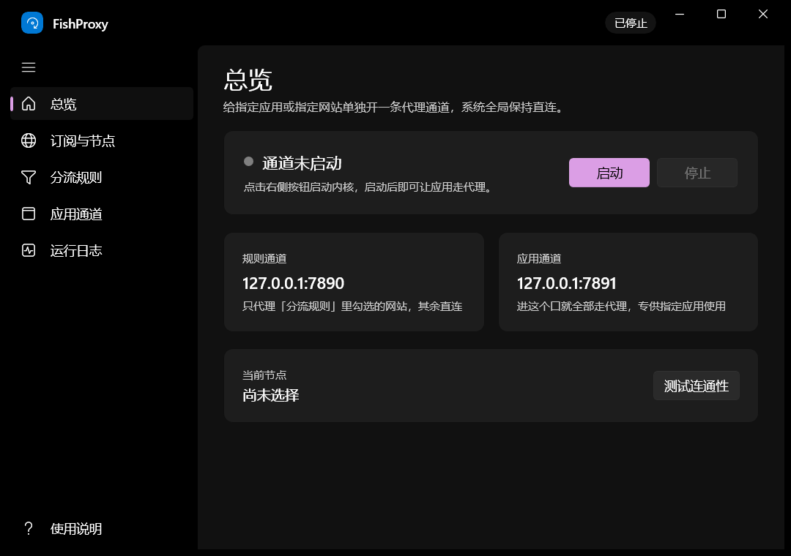

# ClashProxy · 单应用代理通道

> **这是一个学习项目。** 用 WinUI 3 + .NET 8 写的练习作品，目的是搞清楚「本地代理内核怎么合成配置、怎么按应用/按网站分流」。项目不含、也不提供任何订阅链接或节点，需要你自己准备 Clash 订阅。仅供学习交流，请遵守当地法律法规与你所用订阅服务的条款。

给**指定应用**和**指定网站**单独开一条代理通道，**系统全局保持直连**——不改 Windows 的代理设置，不在后台挂任何全局钩子，其它程序的网络行为完全不受影响。

界面是 WinUI 3 原生应用，内核用 [mihomo](https://github.com/MetaCubeX/mihomo)。



- 开发者：[fotlim](https://github.com/fotlim)
- 项目地址：[github.com/fotlim/clashproxy](https://github.com/fotlim/clashproxy)
- 协议：MIT（内核 mihomo 为 GPL-3.0，见 [LICENSE](LICENSE)）

---

## 下载与安装

到 [Releases](https://github.com/fotlim/clashproxy/releases) 下载，两种任选：

| 文件 | 说明 |
| --- | --- |
| `ClashProxy-1.0.0-setup-x64.exe` | **安装版**。双击安装，自动建开始菜单和桌面快捷方式，可从「应用和功能」卸载 |
| `ClashProxy-1.0.0-portable-win-x64.zip` | **绿色便携版**。解压到任意目录双击 `ClashProxy.exe` 即可，不写注册表、不装服务 |

两者功能完全一样，只是便携版把数据放在 `%LOCALAPPDATA%\ClashProxy`（可用 `CLASHPROXY_DATA` 环境变量改到别处）。

> 系统要求：Windows 10 1809 及以上 / Windows 11（x64）；需要 [.NET 8 桌面运行时](https://dotnet.microsoft.com/download/dotnet/8.0) 和 [Windows App Runtime 1.8](https://learn.microsoft.com/windows/apps/windows-app-sdk/downloads)。安装包会在缺依赖时提示你。

---

## 它到底解决什么

平时开 Clash 那类工具，是「全局接管」：要么改系统代理，要么装 TUN 虚拟网卡，整台机器的流量都被卷进去。
可很多时候你只想要一件事——**让这一个程序、或者只让这几个网站，走代理，别的照旧直连**。

ClashProxy 做的就是这一件事。它同时开两个本地端口：

| 端口 | 名字 | 行为 |
| --- | --- | --- |
| `127.0.0.1:7890` | **规则通道** | 按「分流规则」判断：列表里的网站走代理，其余一律直连 |
| `127.0.0.1:7891` | **应用通道** | 不做任何判断，进来的流量**全部**走代理 |

系统代理设置一个都不动。你把哪个程序指到 `7891`，就只有那个程序全走代理；把哪个程序指到 `7890`，它访问列表内网站才走代理。

---

## 快速上手

### 1. 打开程序

双击 `ClashProxy.exe`。首次启动会在 `%LOCALAPPDATA%\ClashProxy` 建数据目录。

> 系统要求：Windows 10 1809 及以上 / Windows 11；需要安装 [.NET 8 桌面运行时](https://dotnet.microsoft.com/download/dotnet/8.0) 和 [Windows App Runtime 1.8](https://learn.microsoft.com/windows/apps/windows-app-sdk/downloads)（多数机器已随其它软件装好；缺失时程序会提示）。

### 2. 导入订阅

左侧「**订阅与节点**」→ 粘贴你的 Clash 订阅链接 → 点「**下载并解析**」。
解析出来 40 多个节点后，挑一个点「**使用选中节点**」（也可以先「全部测速」看延迟）。

### 3. 生成配置并启动

点「**应用到内核**」→ 回到「**总览**」→ 点「**启动**」。

这时 `7890` / `7891` 两个端口都已在监听，但**系统网络没有任何变化**——只有你主动把程序指过来的流量才会走代理。

### 4. 让某个网站走代理

「**分流规则**」→ 在输入框填域名（如 `google.com`）→ 点「**添加**」→ 点「**保存并应用**」。

之后凡是把代理指向 `127.0.0.1:7890` 的程序，访问 `google.com` 及其子域会走代理，访问别的（如 `baidu.com`）仍然直连。

- 首次使用可以直接点「**导入常用列表**」，一次加入 32 条常用境外域名。
- 规则类型：`域名后缀` 最常用（`google.com` 覆盖 `www.google.com`）／`精确域名` 只匹配那一个／`关键字` 按子串匹配。

### 5. 让某个应用走代理（最常用）

「**应用通道**」→ 点「**添加程序…**」选一个 exe → 点它右边的「**走代理启动**」。

ClashProxy 启动它时会注入：

```
HTTPS_PROXY=http://127.0.0.1:7891
HTTP_PROXY=http://127.0.0.1:7891
ALL_PROXY=http://127.0.0.1:7891
NO_PROXY=localhost,127.0.0.1,::1,*.local
```

因为这个端口不做规则判断，所以这个程序**所有**外网流量都会走代理；系统里其它程序一点不受影响。

### 6. 命令行/脚本也想要代理

在 cmd 里先设两行，只影响当前窗口：

```bat
set HTTPS_PROXY=http://127.0.0.1:7891
set HTTP_PROXY=http://127.0.0.1:7891
```

PowerShell：

```powershell
$env:HTTPS_PROXY = "http://127.0.0.1:7891"
$env:HTTP_PROXY  = "http://127.0.0.1:7891"
```

只想让部分网站走代理时，把 `7891` 换成 `7890` 即可。

---

## 界面一览

| 页面 | 干什么 |
| --- | --- |
| **总览** | 启动/停止内核，看两个端口、当前节点、连通性测试 |
| **订阅与节点** | 下载订阅、列节点、全部测速、选节点并切换 |
| **分流规则** | 增删域名规则、常用列表一键导入、保存并应用（自动重启内核） |
| **应用通道** | 维护「走代理启动」的程序清单，一键带代理启动 |
| **运行日志** | 内核输出与应用事件，实时滚动 |
| **使用说明** | 内置同一份教程 |

---

## 发布包结构

```
ClashProxy\
├─ ClashProxy.exe            主程序
├─ Assets\bin\mihomo.exe    内核（不需要另外装 Clash）
├─ Assets\bin\geoip.metadb  地理库
└─ 其余 dll / pri           运行时依赖
```

数据目录 `%LOCALAPPDATA%\ClashProxy`：

```
config.yaml          启动内核用的合成配置（自动生成，改了会被覆盖）
settings.json        界面里的全部设置
profiles\current.yaml 上次下载的原始订阅
logs\kernel.log      内核输出
logs\startup.log     启动诊断日志
```

想把数据放到别处（便携模式），启动前设一个环境变量即可：

```bat
set CLASHPROXY_DATA=D:\ClashProxyData
ClashProxy.exe
```

---

## 常见问题

**启动后网页打不开？**
先看「运行日志」。多数是节点不通 —— 回「订阅与节点」测速换个节点；也可能是订阅本身过期了，重新下载一次。

**改了规则没生效？**
点「保存并应用」会自动重启内核，等它自己转一圈即可（页面会提示「已保存并重启内核」）。

**程序带了环境变量还是不走代理？**
环境变量只在**进程启动时**读取，已经在跑的必须先关掉再用「走代理启动」。
另外有些程序（部分 Chromium 系浏览器、个别游戏客户端）不认环境变量，需要它自己的参数，例如：

```bat
chrome.exe --proxy-server="http://127.0.0.1:7891"
```

**会不会影响系统其它程序？**
不会。ClashProxy 不改注册表里的系统代理，不装 TUN 驱动，不设置全局环境变量。唯一的副作用是本机多了两个监听在 `127.0.0.1` 上的端口。

**怎么彻底停掉？**
点「停止」，或者直接关掉窗口 —— 关闭窗口时会自动结束内核进程。

就算你在任务管理器里**强杀** `ClashProxy.exe`，内核也会跟着一起消失：启动内核时它被挂进了一个带 `KILL_ON_JOB_CLOSE` 的 Windows 作业对象，主进程一没，系统立即回收它。
万一还是遇到了残留（比如断电、蓝屏），下次启动 ClashProxy 会自动清扫——只清路径等于本程序自带那份 `mihomo.exe` 的进程，不会误杀你自己装的 Clash / Verge。

卸载就是把程序目录删掉，再删 `%LOCALAPPDATA%\ClashProxy`（或者你指定的 `CLASHPROXY_DATA` 目录）。

**端口被占用？**
`7890`/`7891`/`9091` 被别的 Clash 类软件占着时，先把那个软件退掉；或改 `settings.json` 里的 `RulePort`/`AppPort`/`ControllerPort` 换个号。

---

## 工作原理（给想改代码的人）

1. **下载订阅** → 原样存到 `profiles\current.yaml`。
2. **合成配置**（`Core\ConfigBuilder.cs`）：从订阅 YAML 里拿 `proxies`，丢掉会打架的键（`port`、`mixed-port`、`mode`、`external-controller`、`rules`、`proxy-groups`、`listeners`、`tun` 等），再写回自己的：
   - `mixed-port = 7890`、`mode = rule`
   - `listeners` 追加一条 `app-channel`：`type=mixed, port=7891, listen=127.0.0.1, proxy=PROXY`
   - `proxy-groups` 生成「自动选择」（url-test）+「PROXY」（select）
   - `rules` 由分流规则生成，末尾固定 `MATCH,DIRECT`
3. **启动内核**（`Core\KernelService.cs`）：`mihomo -d <数据目录> -f config.yaml`，逐行接管 stdout/stderr 进日志。
4. **控制接口**：`127.0.0.1:9091`（mihomo REST API），用来切节点、测延迟。
5. **指定应用**：`ProcessStartInfo.Environment` 注入 `HTTP(S)_PROXY` 指向 `7891`，子进程自然继承。

---

## 已知限制

- 只对「愿意读 `HTTP(S)_PROXY` 环境变量」的程序有效；不认环境变量的程序需要它自己的代理参数。
- 不支持 UDP / 游戏流量（没有做 TUN）。
- 内核暂不做热加载，改配置走「重启内核」这条路（界面上自动完成）。
- 订阅里的 `proxy-providers` 远程节点源不会被保留，只保留内联 `proxies`。

---

## 从源码构建

不需要 Visual Studio，装个 [.NET 8 SDK](https://dotnet.microsoft.com/download/dotnet/8.0) 就够了：

```bat
cd src\ClashProxy
dotnet build -c Debug -p:Platform=x64
dotnet publish -c Release -p:Platform=x64 -r win-x64 --self-contained false -o ..\..\dist\ClashProxy
```

打包（安装包 + 便携版 zip）用仓库里的脚本，需要本机装有 [Inno Setup 6](https://jrsoftware.org/isinfo.php)：

```bat
powershell -NoProfile -ExecutionPolicy Bypass -File tools\build-release.ps1
```

产物在 `release\`：`ClashProxy-1.0.0-setup-x64.exe`、`ClashProxy-1.0.0-portable-win-x64.zip`、`SHA256SUMS.txt`。

端到端自测（起本地订阅源，用 UIAutomation 驱动界面，验证两条通道真的是代理出口）：

```bat
powershell -NoProfile -ExecutionPolicy Bypass -File tools\e2e-test.ps1
powershell -NoProfile -ExecutionPolicy Bypass -File tools\app-channel-test.ps1
```

---

## 致谢与许可

- 代理内核：[MetaCubeX/mihomo](https://github.com/MetaCubeX/mihomo)（GPL-3.0），随包分发的是其官方 Windows 构建。
- 本项目自身代码以 [MIT](LICENSE) 协议开源，© 2026 [fotlim](https://github.com/fotlim)。
- 再次说明：这是个学习项目，不提供任何订阅或节点，也不对使用后果负责。